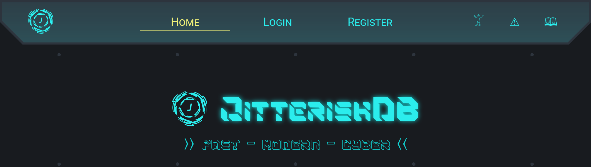

JitterishDB
===========



Authors:

- mkb (Markus Bauer)
- SingleChar (Simeon Hoff)

Categories:

- Pwn
- Misc

Overview
--------

JitterishDB is the best cloud storage your company could possibly rent!

It is a storage service with a web frontend. You can store data and retrieve it again. Data access is via JIT-compiled queries.

Example:
```
func is_in_team(entry, teamname) { return entry["team"] == teamname; }
func get_points(entry) { return entry["points"]; }
func sum(data, acc) { return data + (acc ?: 0); }

query all_entries on data1;
query team_points on data1 filter is_in_team map get_points reduce sum; 
```

### Web frontend

- User management
- Selects target database
- Users can submit queries or run pre-defined ones

### Database engine

- Receives queries from users
- Invokes the JIT to compile the query language
- Invokes the compiled queries within a context
- Only the database engine can write data

### JIT Compiler

- Produces executable files from user code
- Compiled files can only read data (of one user)


Flag Stores
-----------

In general, we store data in user databases or the user profile (which is just a database of the system account. 

The rough idea is to have at least one flag stores per component (so at least 3 in total, frontend, db engine, jit).

We give out the username of each flag store as attack info / flag ID.

### Flag Store 1

The first flag store is an account with a private and a public table (account type: community). 
Attackers can run JIT code against the public table but not the private table.
Bypassing the JIT limits (or RCE) gives access to the private table.

### Flag Store 2

A user with a flag in its "custom" profile data (account type: business).

### Flag Store 3

An account with only private tables, but pre-defined queries that everybody can trigger (account type: enterprise).
There's a (pre-defined, fixed) API script bound to these accounts, which allows append and limited query operations.


Vulnerabilities
---------------

### Flag Store 1, Vuln 1 (RCE in JIT Compiler output)

RCE in jitted queries: You can link against libc functions (`system` here).
The JIT language never stores pointers in registers, but certain runtime functions (`jit_rt_equal` here) can leave a valid pointer in $rdi. 
```
func hack() {
    "cat *.ndjson" == "cat *.ndjson";
    system();
    return 0;
}
```

- Difficulty: medium to hard
- Discoverability: medium (obvious if you know how linkers work, not so obvious otherwise)
- Patchability: medium
- Categories: pwn

### Flag Store 1, Vuln 2 (Override symbols in JIT Compiler runtime)

You can override permission checks in the runtime library by re-defining their internal symbols.
Symbols in the compiled binary have precedence over imported symbols from the library.
```
func _ZN11DataStorage8isPublicEv(){ return true; }
```

- Difficulty: medium
- Discoverability: hard
- Patchability: easy
- Categories: pwn

### Flag Store 2, Vuln 1 (protocol desync)

You can desync the protocol between website and engine if the jit outputs invalid data (e.g., `undefined`).
Triggering the desync on the complaints endpoint allows you to load another user's data to your session.
- Difficulty: medium to hard
- Discoverability: hard
- Patchability: medium
- Categories: misc

### Flag Store 3, Vuln 1 (newline injection in database storage format)

Both website and database engine use serde's `RawValue` to pass json from API to database storage, which preserves formatting.
If we append a value which includes a newline, we break the engine's ndjson storage format, which allows us to write arbitrary data to a collection.
There's a collection including authentication data, so we can authenticate ourselves for any stored data.
- Difficulty: medium
- Discoverability: hard
- Patchability: easy
- Categories: misc


Patches
-------

### Flag Store 1, Vuln 1 + 2

Prefix all jitted functions with something, both in calls and in function definitions.
If you want to be super safe, you can also check the number of arguments, but imho that's not exploitable.

### Flag Store 2, Vuln 1

Properly handle connection errors, or typecheck user registration.
Or open a new connection per query.

### Flag Store 3, Vuln 1

Replace `RawValue` with `Value`, either in engine or website.


## Current status

- Service ready and playable.
- Checkers ready and tested.
- Exploits working.


Work Packages
-------------

### WP 1: JIT

#### WP 1.1: JIT Prototype

Implement JIT as described above, including tests. 

#### WP 1.2: JIT Vulnerabilities

Atleast two vulnerabilities for flag store 1

### WP 2: Database Engine

#### WP 2.1: Database Prototype

Implement database engine as described above.

#### WP 2.2: Database Isolation

Sandboxing for isolation of the RCEs (flag store 1 vulns).

#### WP 2.3: Database Vulnerability

Implement flag store 2 vulnerability.

### WP 3: Web Frontend

#### WP 3.1: Frontend Prototype

Implement a frontend as described above.
Features of that frontend scale on the amount of code already written - if the service is going too large, we'll cut short here.

#### WP 3.2: Web Flagstore

Implementation of flag store 3 and vulnerability.

#### WP 3.3: Web Styling

Make frontend look sleek and fit well into CTF theme.

### WP 4: Checker

#### WP 4.1: User Registration

User registration test using the frontend

#### WP 4.2: Database Noise

Queries against the database which dont involve flag.

#### WP 4.3: Flagstore 1 retrieval

Implement flag put / get methods for flagstore 1.

#### WP 4.4: Flagstore 2 retrieval

Implement flag put / get methods for flagstore 2.

#### WP 4.5: Flagstore 3 retrieval

Implement flag put / get methods for flagstore 3.

#### WP 4.6: Exploits

Implement exploits for intended vulns.

